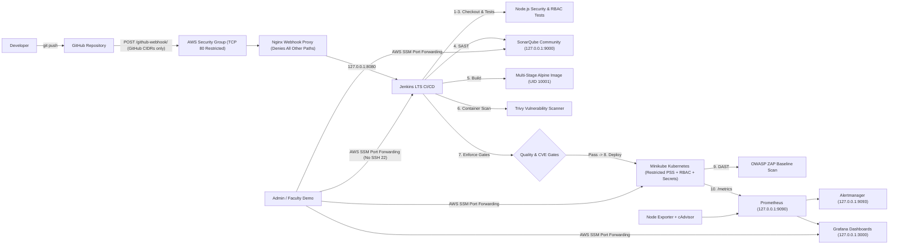

# VLE-9 Secure DevSecOps Architecture — SecureCare Healthcare System

## 1. System Overview

This project implements an independent, end-to-end DevSecOps pipeline for **SecureCare**, a synthetic healthcare records and outpatient appointment application running on hardened AWS infrastructure in `ap-south-1`.

---

## 2. Security-in-Depth Layers

| Layer | Security Controls Implemented |
|---|---|
| **Cloud & Network** | Isolated VPC (`10.90.0.0/16`); **SSH port 22 closed**; **zero `0.0.0.0/0` ingress**; TCP 80 restricted to GitHub official webhook CIDRs; Nginx blocks every URL except `POST /github-webhook/`; IMDSv2 enforced with `hop_limit = 1`; encrypted 40 GB `gp3` EBS volume; least-privilege IAM instance profile for AWS SSM only. |
| **Access & Admin** | All management and UI access (Jenkins, SonarQube, Grafana, Prometheus, Alertmanager, SecureCare) bound to `127.0.0.1` and accessed exclusively via encrypted AWS SSM Session Manager port forwarding. |
| **Application (SecureCare)** | 100% synthetic demo data (zero real PHI); runtime-only secrets via environment/Kubernetes Secret; `scrypt` password hashing with `timingSafeEqual`; HMAC-SHA256 signed `HttpOnly; SameSite=Strict` cookies; strict input validation & XSS prevention; `helmet` CSP/X-Frame-Options/nosniff/Permissions-Policy; zero PII/secrets in structured JSON logs. |
| **SAST & Container** | SonarQube automated static code analysis + Quality Gate check; multi-stage `node:22-alpine` Dockerfile with `apk upgrade`, non-root UID `10001`, `.dockerignore`; Trivy image vulnerability scan enforcing zero fixable HIGH/CRITICAL CVEs. |
| **Kubernetes (Minikube)** | Dedicated `securecare` namespace enforcing Kubernetes **Restricted** Pod Security Standard; least-privilege `ServiceAccount` + `Role` + `RoleBinding`; `automountServiceAccountToken: false`; `readOnlyRootFilesystem: true`; `capabilities.drop: ["ALL"]`; CPU/memory limits; readiness & liveness probes. |
| **DAST & Observability** | OWASP ZAP baseline scan against deployed Kubernetes service; Prometheus + Node Exporter + cAdvisor + Alertmanager + Grafana monitoring host resources, container health, HTTP traffic, failed logins, and 401/403 unauthorized access spikes. |

